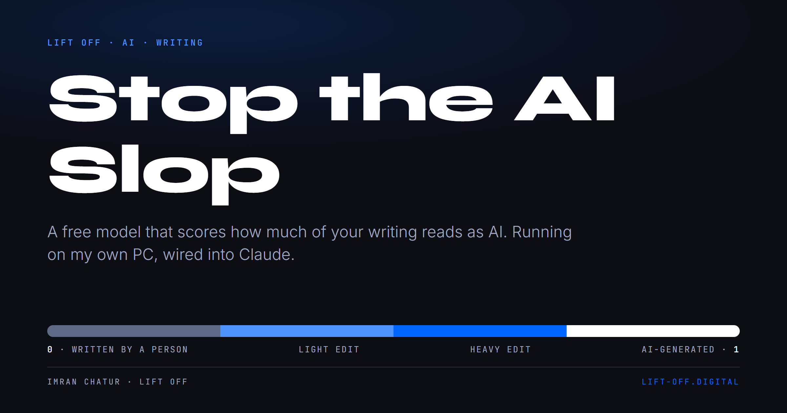
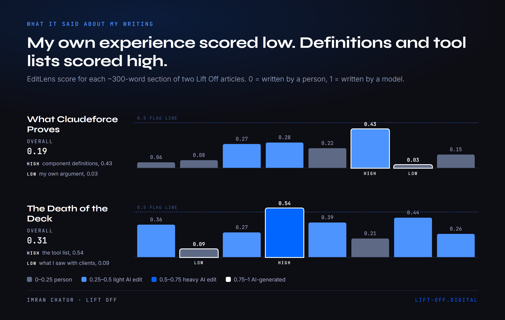
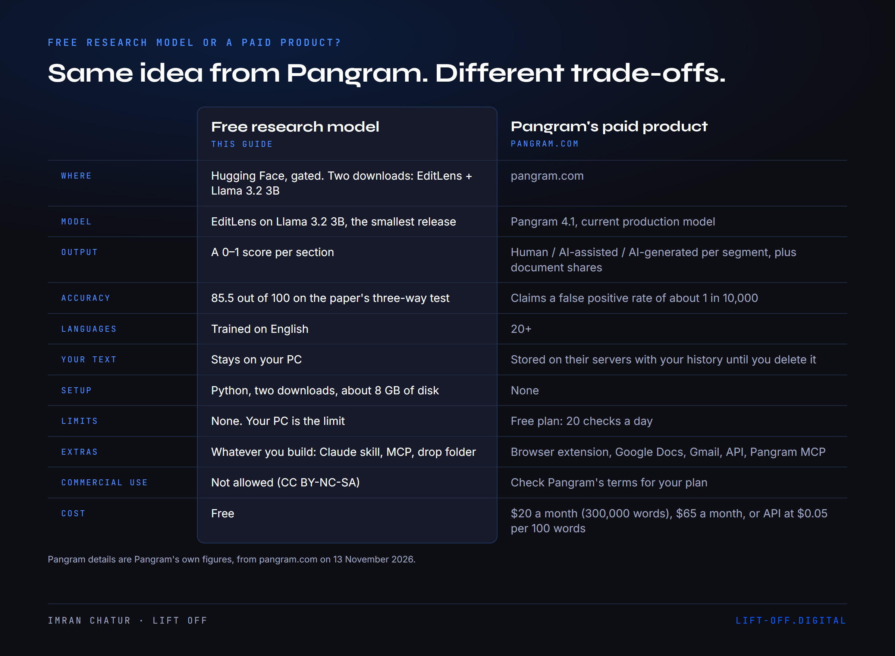
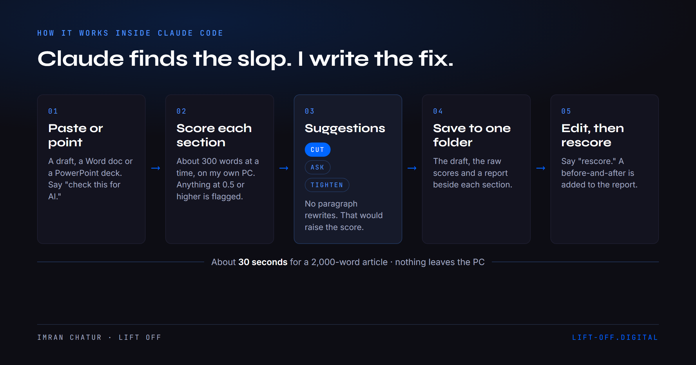
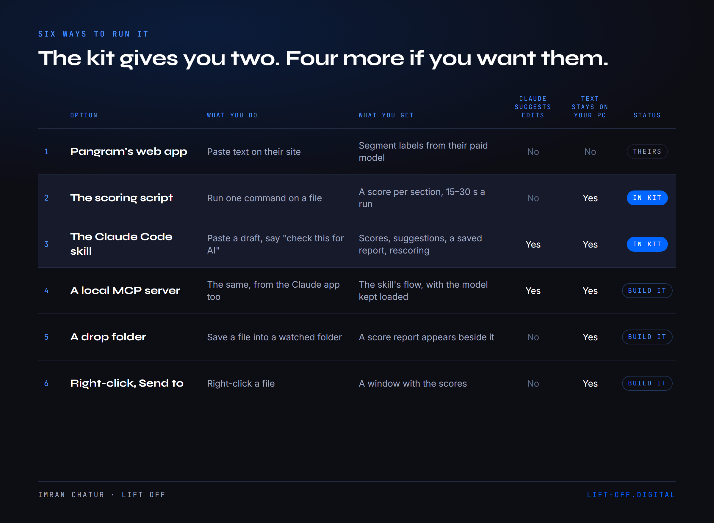

# Stop AI Slop



Score your own writing for how much it reads as AI, on your own PC, and get edit suggestions in Claude Code.

This kit runs **EditLens**, a research model from Pangram Labs (ICLR 2026), on an ordinary processor. No graphics card needed. It gives each section of a draft a score from 0 to 1:

| Score | Roughly |
|---|---|
| 0.00 – 0.25 | Written by a person |
| 0.25 – 0.50 | Lightly edited by AI |
| 0.50 – 0.75 | Heavily edited by AI |
| 0.75 – 1.00 | Mostly or fully AI-generated |

The bands are an approximate split of the score, not Pangram's published thresholds.

What it looks like on two real articles, one bar per ~300-word section:



Written up in Lift Off: "Stop the AI Slop" on [liftoffai.substack.com](https://liftoffai.substack.com)

## What is in here

| File | What it does |
|---|---|
| `score.py` | Scores text, Markdown, Word (.docx) and PowerPoint (.pptx) files, whole or section by section |
| `skill/editlens/SKILL.md` | A Claude Code skill: paste a draft, say "check this for AI", get scores, suggestions and a saved report |
| `setup.ps1` | Windows installer: Python environment, libraries and the skill |
| `requirements.txt` | Python libraries, for installing by hand |
| `images/` | The graphics from the article |

## Free research model or Pangram's paid product?

This kit uses the **free research release**: the smallest model Pangram published, downloaded from Hugging Face and run on your machine. Your text never leaves your PC, and there is no limit on checks. It is for non-commercial use only.

**Pangram's paid product** at pangram.com runs a larger, newer production model and needs no setup. Use it if you need commercial use, higher accuracy, an API, or don't want to install anything. Its free plan allows a limited number of checks a day. Your text goes to their servers.



## What you need

- A PC with at least 16 GB of memory. The model uses about 7 GB while it runs.
- About 8 GB of free disk: 6 GB for the model, 1 GB for the Python libraries.
- Python 3.12 or newer: https://www.python.org/downloads/
- A free Hugging Face account: https://huggingface.co
- Claude Code, for the skill. The scorer works without it.

## Setup (Windows)

**1. Get access to the two downloads.** Both are free and gated.

- EditLens adapter (49 MB): accept the terms at https://huggingface.co/pangram/editlens_Llama-3.2-3B. Approval is automatic.
- Meta Llama 3.2 3B base model (6 GB), which EditLens sits on top of: request access at https://huggingface.co/meta-llama/Llama-3.2-3B. A person reviews requests, so this can take a while.
- Create a token with **Read** access: Hugging Face → Settings → Access Tokens.

Download only from Pangram's own page. Other copies exist on Hugging Face.

**2. Get this kit.** Click **Code → Download ZIP** and unzip it, or:

```
git clone https://github.com/imranchatur-cpu/AI-Slop-Public.git
cd AI-Slop-Public
```

**3. Run the installer** from the kit folder in PowerShell:

```
powershell -ExecutionPolicy Bypass -File .\setup.ps1
```

It creates `.venv`, installs the CPU build of PyTorch and the libraries, and installs the Claude Code skill to `%USERPROFILE%\.claude\skills\editlens`. If a skill already exists there it is backed up first. Use `-NoSkill` to skip the skill.

**4. Sign in to Hugging Face** and paste your token:

```
.\.venv\Scripts\hf.exe auth login
```

**5. Test it.** The first run downloads about 6 GB.

```
.\.venv\Scripts\python.exe score.py --text "Paste a paragraph of your own writing here"
```

**6. Use it in Claude Code.** Start a new session, paste a draft (or give it a file path) and say "check this for AI", or type `/editlens`.

Short on disk space on your main drive? Set the environment variable `HF_HOME` to a folder on a bigger drive before step 5.

## Setup (Mac or Linux, untested)

The kit was built and tested on Windows. These steps should work but have not been tested:

```
python3 -m venv .venv
.venv/bin/python -m pip install torch
.venv/bin/python -m pip install -r requirements.txt
.venv/bin/hf auth login
.venv/bin/python score.py --text "Paste a paragraph of your own writing here"
```

For the skill, copy `skill/editlens/SKILL.md` to `~/.claude/skills/editlens/SKILL.md` and replace `{{PYTHON}}`, `{{KIT_DIR}}` and `{{RUNS_DIR}}` with your own paths (for example `/Users/you/stop-ai-slop/.venv/bin/python`).

## Using the scorer

```
python score.py draft.md                          # whole text, first ~750 words
python score.py --sections draft.docx             # a score per ~300-word section, with line numbers
python score.py --sections deck.pptx --json out.json
python score.py --dump-text draft.docx            # show the text it extracted, no model
```

It reads `.txt`, `.md`, `.docx` and `.pptx`. For a PDF or a Google Doc, export to `.docx` or `.txt` first, or hand it to Claude: the skill converts other formats to text before scoring.

A run takes 15 to 30 seconds on a normal PC, most of it loading the model. When it finishes, the model is unloaded and the memory is freed.

## How the Claude skill works



1. Saves your draft (or uses your file where it is).
2. Scores it section by section.
3. Flags sections at 0.5 or higher and gives 2 to 4 suggestions for each:
   - **Cut:** a phrase to delete.
   - **Ask:** a question only you can answer, to replace a generic line with a specific one.
   - **Tighten:** a short rewrite of one sentence.
4. Saves the draft, raw scores and a report to one folder.
5. Rescores when you say "rescore" and adds a before-and-after.

It never rewrites whole paragraphs. Text Claude writes is AI text, so a rewrite would raise the score.

## If something goes wrong

- **"Hugging Face refused the download"**: Meta has not approved your request yet, or you have not signed in. Check your email, then run `hf auth login`.
- **A warning about symlinks on Windows**: harmless. Downloads take a little more disk space.
- **"No module named …"**: you ran the system Python. Use `.\.venv\Scripts\python.exe`.
- **"Python was not found"**: install Python 3.12+ and tick "Add python.exe to PATH".

## Ideas for other ways to run it

Not included in this kit:



- **A local MCP server** that keeps the model loaded, so checks take seconds and work in the Claude desktop app as well as Claude Code.
- **A drop folder** watched by a small script, which writes a report next to any draft you save into it.
- **A right-click "Send to" item** that scores a file and shows the result.

## Limits

- This is the smallest EditLens model Pangram released. The paper's headline results came from a larger model that was not released.
- A score measures AI editing, not quality, and it is not proof about anyone's writing. Use it on your own.
- Trained on English text.
- Scores on text under about 120 words are unreliable.

## Credits and licence

- EditLens: Katherine Thai, Bradley Emi, Elyas Masrour and Mohit Iyyer. [Paper](https://arxiv.org/abs/2510.03154), [code](https://github.com/pangramlabs/EditLens), [models](https://huggingface.co/pangram).
- Kit: Imran Chatur, [Lift Off](https://lift-off.digital).

CC BY-NC-SA 4.0. Non-commercial use only. See [LICENSE.md](LICENSE.md). Not affiliated with or endorsed by Pangram Labs or Meta.

Scripts and skills run with access to your machine. Read them before you run them.
